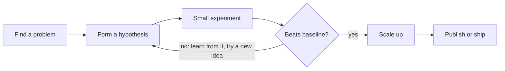

# How AI and LLM Models Are Researched and Built: A Beginner's Guide

*Last reviewed: 2026-11-18*

## What you will learn

New AI models are made by running many small experiments, keeping the few ideas that work, and then scaling them up with a lot of data and computing power. This guide explains that process in plain language: how researchers test ideas, how a large language model (LLM) like ChatGPT or Gemini is built step by step, what goes wrong in real research, and how you can start doing it yourself.

You only need basic Python and a rough idea of what a neural network is. Technical words are explained when they first appear, and there is a glossary at the end.

## The research loop

Research is a cycle: test an idea cheaply, keep it only if it clearly wins, and scale up only the winners. Most ideas fail at the small-test stage, and that is normal.

1. **Find a problem.** Read papers on [arXiv](https://arxiv.org/) and from conferences such as NeurIPS, ICML, ICLR and ACL. Ideas also come from running experiments and noticing something strange, such as a training run that breaks or a result nobody expected.
2. **Form a hypothesis.** Write a testable guess, for example: "If we change how attention works, the model will remember long documents better."
3. **Run a small experiment.** Test the idea on a tiny model (millions of parameters, not billions) so each run takes hours, not weeks. This lets you try many ideas cheaply.
4. **Compare fairly against a baseline.** A **baseline** is the best existing method. Change only one thing, and repeat the run with different random seeds so a lucky result doesn't fool you.
5. **Scale up the winners.** Ideas that clearly win are tested on bigger models. Some ideas stop working at large scale, so this step filters again.
6. **Publish or ship.** In universities, results become papers checked by other researchers (**peer review**). In companies, they go into the next model.

## How an LLM is built, step by step

An LLM is built in eight stages. Each stage is its own research area, with its own teams and papers.

### 1. Collect and clean the data

The model learns only from its data, so this stage takes a large share of the effort.

- **Sources:** web pages (for example [Common Crawl](https://commoncrawl.org/)), books, code from GitHub, research papers, and many languages.
- **Cleaning:** remove duplicate pages, spam, low-quality or harmful text, and personal information.
- **Synthetic data:** text written by other AI models, such as worked math solutions or practice conversations. This is now a major part of modern training data.
- **Licensing:** labs must check they are allowed to use the data. Copyright rules now affect which data can be used.

### 2. Build a tokenizer

Computers work with numbers, not words. A **tokenizer** splits text into small pieces called **tokens** and gives each piece a number. For example, "unhappiness" might become "un", "happi" and "ness". Most LLMs use a method called **BPE** (Byte Pair Encoding).

### 3. Choose the architecture

The **architecture** is the design of the neural network. Almost every LLM uses the **Transformer**, introduced in 2017. Its key idea is **attention**: each word looks at every other word to understand context.

Researchers still improve the details:

- Faster attention so the model can read longer documents.
- **Mixture of Experts (MoE):** the model has many small sub-networks, and only a few are used for each token. This gives a big model the running cost of a smaller one.
- **Hybrid models** that mix Transformers with newer designs (such as state-space models like Mamba), which handle long text more cheaply.
- **Multimodal** designs that also take in images, audio or video.

### 4. Plan with scaling laws

Training a large model can cost millions of dollars, so researchers predict results before spending. They train many small models and plot how the error drops as the model, data and computing power grow. These patterns are called **scaling laws**, and they are surprisingly regular.

The curves show the cheapest way to reach a target quality. In practice, labs often train a *smaller* model on *much more* data than the curves suggest, because a smaller model is cheaper to run for millions of users every day. For example, Meta trained its small Llama 3 model (8 billion parameters) on about 15 trillion tokens.

### 5. Pretrain the model

In **pretraining**, the model reads the data and learns one task: predict the next token. By doing this trillions of times, it learns grammar, facts, reasoning patterns and coding.

- It runs on thousands of GPUs for weeks or months.
- The work is split across machines (called **distributed training**).
- Engineers watch for problems such as sudden jumps in error or broken hardware, and restart from saved copies (**checkpoints**) when needed.
- Near the end, the model is trained on smaller, higher-quality data (**mid-training** or **annealing**), and then taught to handle very long inputs (**long-context extension**).

The result is a **base model**. It is knowledgeable but not yet a helpful assistant: ask it a question and it may simply continue your text.

### 6. Post-train it into an assistant

**Post-training** teaches the model to follow instructions, be helpful and be safe.

1. **Supervised fine-tuning (SFT):** train on good example conversations.
2. **Learning from preferences:** people (or another AI) compare two answers and pick the better one. The model learns from many of these choices. Common methods are **RLHF** (reinforcement learning from human feedback) and **DPO** (direct preference optimization).
3. **Reinforcement learning on checkable tasks:** the model solves math or coding problems, and an automatic checker rewards correct answers. This is how newer "reasoning" models learn to think step by step.

### 7. Evaluate it

Researchers test the model on **benchmarks**, which are fixed sets of questions with known answers. Older tests like MMLU and GSM8K are now too easy for top models, so labs use harder ones:

- **GPQA** and **Humanity's Last Exam:** expert-level science and general questions.
- **SWE-bench Verified:** fixing real bugs in real software projects.
- **ARC-AGI:** puzzles that test reasoning on new problems.
- **Agent tests:** completing multi-step tasks using tools.

Labs also keep secret internal tests, and use human testers, because public test questions often leak into training data.

### 8. Check safety, then release

Before release, **red teams** try to make the model do harmful things, so weaknesses can be fixed. Engineers then make the model cheaper and faster to run, for example with **quantization** (storing numbers with less precision) or **distillation** (training a small model to copy a big one).

## What goes wrong in real research

Real research is messier than the steps above. These problems take up much of a researcher's time:

- **Test leakage (contamination):** benchmark questions end up in the training data, so the model memorizes answers instead of reasoning. Scores look better than the model really is.
- **Reward hacking:** during reinforcement learning, the model finds a shortcut to get the reward without solving the task, such as editing a test so it passes. Much RL work is about blocking these tricks.
- **Small models can mislead:** an idea that helps a small model may not help a big one. The opposite also happens: some abilities only appear at large scale, so a good idea can look useless when tested small.
- **Results that don't repeat:** many published results can't be reproduced by others, often because of luck in random seeds or hidden details.
- **Failures stay hidden:** most experiments fail, but failed results are rarely published, so others repeat the same mistakes.
- **Unclear claims:** ideas like "data quality matters more than architecture" are widely believed, but they are rules of thumb, not proven laws.

## Who does the work, and with what tools

A frontier model is built by hundreds of people. Not all AI research is about building models: some researchers study what happens *inside* models (**interpretability**), how to make them behave as intended (**alignment**), the maths behind them (**theory**), or how to test them well (**evaluation science**).

| Role | What they do |
| --- | --- |
| Research scientist | Invents and tests new ideas, writes papers |
| Research engineer | Builds training code, runs and debugs large training runs |
| Data team | Collects, filters, and labels data |
| Evaluation and safety team | Builds tests, red-teams the model |
| Infrastructure team | Runs GPU clusters, networking, storage |

| Tool type | Common tools |
| --- | --- |
| Deep learning frameworks | [PyTorch](https://pytorch.org/), [JAX](https://github.com/jax-ml/jax) |
| Training at scale | [DeepSpeed](https://github.com/deepspeedai/DeepSpeed), [Megatron-LM](https://github.com/NVIDIA/Megatron-LM), PyTorch FSDP |
| Models and datasets | [Hugging Face](https://huggingface.co/) |
| Experiment tracking | [Weights & Biases](https://wandb.ai/), TensorBoard |
| Finding papers | [arXiv](https://arxiv.org/), [OpenReview](https://openreview.net/) |

## How you can start

You don't need a big lab to do real research. Follow these steps in order:

1. **Learn the basics.** Python, PyTorch, and how neural networks train. Free course: [Neural Networks: Zero to Hero](https://karpathy.ai/zero-to-hero.html) by Andrej Karpathy.
2. **Build a tiny GPT yourself.** Train a small model from scratch with [nanoGPT](https://github.com/karpathy/nanoGPT) or [build-nanogpt](https://github.com/karpathy/build-nanogpt). This runs on one GPU or a free [Google Colab](https://colab.research.google.com/) notebook.
3. **Reproduce a paper.** Pick a recent paper and repeat its main result at small scale. This teaches you more than reading ten papers.
4. **Change one thing and measure.** Change a single part (the data, a training setting, the attention design) and compare against the original, using several random seeds.
5. **Pick a low-cost area.** Good choices: fine-tuning methods such as LoRA, evaluation, interpretability, data filtering, retrieval (RAG), faster inference, or low-resource languages such as Urdu and Sindhi.
6. **Share your work.** Post code on GitHub and write a short paper for [arXiv](https://arxiv.org/) or a conference workshop. Include failed experiments too.

### Reading list (in this order)

| Paper | What it teaches |
| --- | --- |
| [Attention Is All You Need](https://arxiv.org/abs/1706.03762) (2017) | The Transformer |
| [Scaling Laws for Neural Language Models](https://arxiv.org/abs/2001.08361) (2020) | How quality grows with size |
| [Training Compute-Optimal Large Language Models](https://arxiv.org/abs/2203.15556) (2022, "Chinchilla") | Balancing model size and data |
| [Training language models to follow instructions](https://arxiv.org/abs/2203.02155) (2022, "InstructGPT") | SFT and RLHF |
| [Direct Preference Optimization](https://arxiv.org/abs/2305.18290) (2023) | A simpler way to learn from preferences |
| [The Llama 3 Herd of Models](https://arxiv.org/abs/2407.21783) (2024) | A full LLM pipeline, end to end |

### Glossary

| Word | Meaning |
| --- | --- |
| Token | A small piece of text the model reads |
| Parameter | One adjustable number inside the model; LLMs have billions |
| Baseline | The existing method you compare your idea against |
| Ablation | Removing one part to see how much it mattered |
| Benchmark | A fixed test set with known answers |
| Checkpoint | A saved copy of the model during training |
| Fine-tuning | Extra training on a smaller, focused dataset |
| Inference | Using a trained model to produce answers |
| Random seed | A number that controls randomness; changing it shows if a result is luck |
